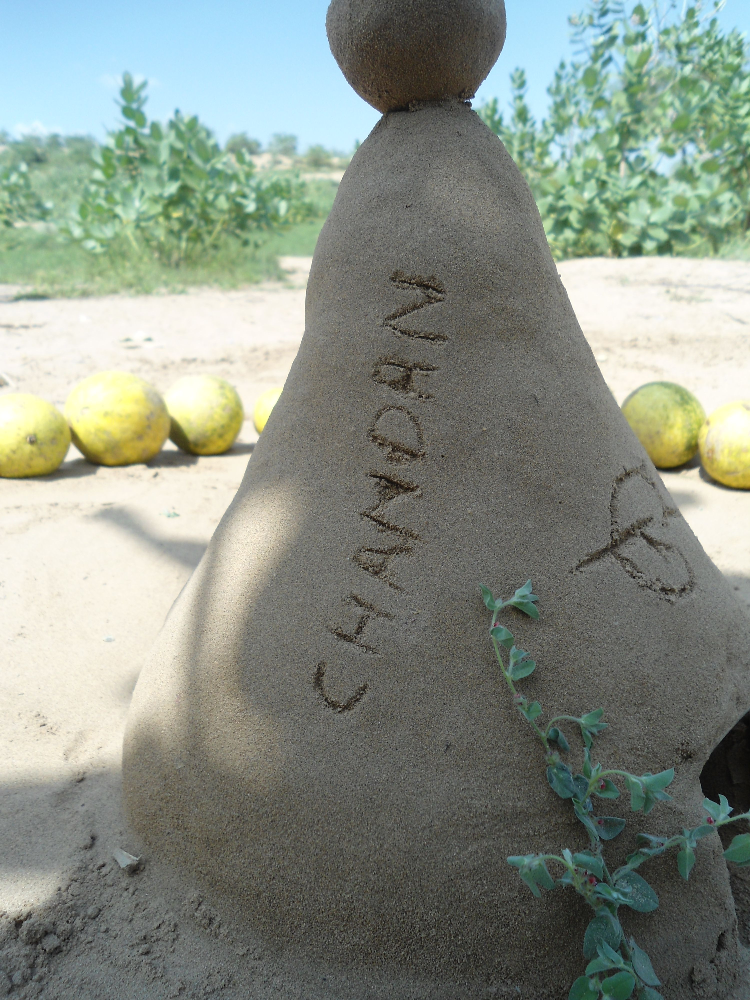

# Gaya Hidup Food: 5 Tren Makanan yang Sedang Naik Daun

> *Catatan untuk Editor CMS:* Artikel ini disusun dalam bahasa Indonesia formal, dengan gaya penulisan yang informatif dan relevan untuk audiens umum. Warna brand: merah (`#B30006`) + gold (`#C9A227`). Kontak: WhatsApp **0851-6593-5577**, Instagram **@kojo_onigiri**.

---

## Pendahuluan

Dalam beberapa tahun terakhir, konsep *food lifestyle* telah berkembang dari sekadar "mengenali makanan" menjadi salah satu aspek penting dari gaya hidup modern. Bukan hanya soal apa yang dinikmati, tetapi juga bagaimana makanan dipilih, disajikan, dan dihubungkan dengan nilai kesehatan, lingkungan, dan identitas budaya.

Bagi pembaca yang hidup di lingkungan perkotaan dan komunitas, tren gaya hidup food ini menjadi bahan menarik untuk dibaca, terutama jika ingin memahami bahwa hidup nyaman tidak harus berhenti di tampilan, tetapi juga mencakup hal-hal sederhana yang berkualitas. Artikel ini membahas lima tren makanan yang sedang naik daun saat ini, lengkap dengan penjelasan dan contoh penerapannya di kehidupan sehari-hari.

---

## 5 Tren Food Lifestyle yang Sedang Naik Daun

### 1. Makanan Sehat dan "Clean Eating"

*Clean eating* atau pola makan yang menekankan makanan utuh (whole foods) mulai populer di Indonesia. Konsep ini mengedepankan pemilihan makanan yang sedikit diproses, kaya nutrisi, dan bebas dari bahan berlebihan yang tidak diperlukan, seperti gula tambahan, pewaris, serta minyak dan garam berlebihan.

**Ciri utama clean eating:**
- Sayuran dan buah-buahan segar
- Protein nabati (tempe, tahu, kacang-kacangan)
- Penghindaran gula tambahan, bahan pengawet, dan olahan berlebihan

Namun, tidak perlu dimaknai sebagai diet membatasi yang berlebihan. *Clean eating* lebih mengarah pada kesadaran memilih bahan yang lebih alami dan dekat dengan sumbernya. Di Indonesia, banyak pilihan lokal yang sudah sesuai, seperti sayur pasar khas Kota, buah musiman, atau produk olahan susu tradisional yang dijaga nilai gizinnya. Prinsip ini cocok diterapkan dalam menu harian, mulai dari bekal siang hingga camilan ringan.

---

### 2. Plant-Based dan Protein Nabati

Selain menjadi perbincangan di kalangan vegan, *plant-based* kini semakin masuk ke lini konsumen umum. Banyak orang mulai menyadari bahwa porsi protein hewani yang terlalu besar dapat dikurangi dengan memanfaatkan kaya protein nabati, tanpa harus sepenuhnya menghilangkan daging.

**Tanda-tanda di mana trend ini tumbuh:**
- Menu dengan kacang-kacangan, lentil, atau produk olahan nabati
- Campuran protein hewani yang lebih sedikit, tetapi tetap seimbang
- Konsumen yang sadar akan dampak pilihan makanan terhadap lingkungan

Di Indonesia, peluangnya besar karena kaya protein nabati yang sudah ada dalam praktik kulinari, seperti tempe, tahu, kacang panjang, dan kacang-kacangan. Bagi yang ingin mencoba, tidak perlu mengubah pola makan drastis; cukup mulai dengan menambahkan satu atau dua porsi nabati dalam sehari.

---

### 3. Functional Foods dan "Food as Medicine"

Banyak manfaat kesehatan yang dicari dari makanan, terutama di tengah meningkatnya kesadaran masyarakat terhadap pencegahan penyakit melalui gaya hidup. Konsep *functional foods* menekankan makanan yang tidak hanya menutrisi, tetapi juga memberikan manfaat tambahan bagi tubuh.

**Contoh praktis:**
- Makanan tinggi serat untuk pencernaan
- Makanan kaya probiotik (yoghurt, kefir, fermented food)
- Minuman herbal dengan kafein rendah (teh hijau, kopi tradisional, kunyit)

Konsep ini mendorong konsumen untuk mempertimbangkan makanan sebagai bagian dari kesehatan, bukan hanya sebagai kenikmatan. Herbs seperti kunyit, temulawak, dan daun sirih memiliki peran dalam masakan sehari-hari maupun minuman tradisional. Pendekatan ini cocok dilestarikan dan dikomunikasikan melalui kegiatan kuliner dan kuliner sehat.

---

### 4. Slow Food dan Local Food

*Local food* atau makanan lokal semakin populer. Konsumen mulai lebih kritis terhadap:
- Asal-usul bahan baku
- Praktik pertanian yang berkelanjutan
- Upaya menjaga warisan kuliner lokal

Gerakan *Slow Food* mendorong konsumen untuk menikmati makanan secara saksama, menghargai proses, dan mendukung produk-produk yang berkelanjutan. Di Indonesia, banyak suku dan daerah yang memiliki kuliner khas dengan resep dan bahan baku khas. Mendorong konsumsi makanan lokal bukan hanya mendukung petani dan pelaku UMKM setempat, tetapi juga melestarikan warisan budaya.

---

### 5. Food Tech dan Smart Food Platform

Terdapat banyak aplikasi dan platform yang memudahkan akses makanan, baik dari sisi pembelian maupun pengelolaan pola makan.

**Contoh penggunaannya:**
- Layanan pesan-makanan (food delivery) yang fleksibel
- Platform *subscription* produk makanan sehat
- Toko bahan makanan online yang terstruktur

Keterlibatan teknologi ini mengubah cara orang mengakses makanan dan bertransformasi dari sekadar "belanja" menjadi proses yang lebih terstruktur. Dengan fitur pemesanan, pembayaran digital, dan rekomendasi menu, pengguna dapat menyesuaikan pilihan makanan dengan kebutuhan gizi dan kenyamanan harian.

---

## Penutup

Gaya hidup food yang sedang naik daun saat ini adalah cerminan dari kebutuhan akan keseimbangan antara hiburan, kesehatan, dan kesadaran lingkungan. Makanan menjadi sarana untuk mengekspresikan nilai hidup, tidak hanya sebagai pelengkap dari kehidupan sehari-hari.

Penting untuk dipahami bahwa tren-tren ini bukan tentang mengikuti tren semata, tetapi tentang membuat pilihan yang lebih menyeluruh dan berkelanjutan. Mulai dari memilih bahan yang lebih alami, mengenali asal-usul makanan, hingga menggunakan teknologi untuk mempermudah akses. Ke depan, food lifestyle akan terus berkembang dan memberikan ruang bagi masyarakat untuk memilah pola makan yang sesuai dengan kebutuhan dan nilai mereka.

> **Untuk informasi lebih lanjut atau permintaan penulisan konten terkait blog, hubungi:**  
> 📞 WhatsApp: **0851-6593-5577**  
> 📸 Instagram: **@kojo_onigiri**

---

## Catatan Grafis & Brand Styling untuk CMS

- **Warna brand:** Merah (`#B30006`) + Gold (`#C9A227`)
- **Font:** Sans-serif standar (misal: Segoe UI, Arial, atau Inter)
- **Ukuran poster dunia:** 4:5 (1080×1350 px) untuk konten kelas properti
- **Tip tampilan:** Gunakan kontras yang baik, gambar foto makanan yang bersih dan terang, jangan gunakan flash berlebihan.
- **Lokasi penyimpanan:** `blog/articles/`

---

## Attribution

Gambar-gambar pada artikel ini dikumpulkan dari Unsplash dalam lisensi Unsplash License (bebas digunakan, crediting opsional):

- **01-clean-eating.jpg** — Photo by Unsplash
- **02-plant-based.jpg** — Photo by Unsplash
- **03-functional.jpg** — Photo by Unsplash
- **04-slow-food.jpg** — Photo by Unsplash
- **05-food-tech.jpg** — Photo by Unsplash

> Lisensi Unsplash: https://unsplash.com/license
