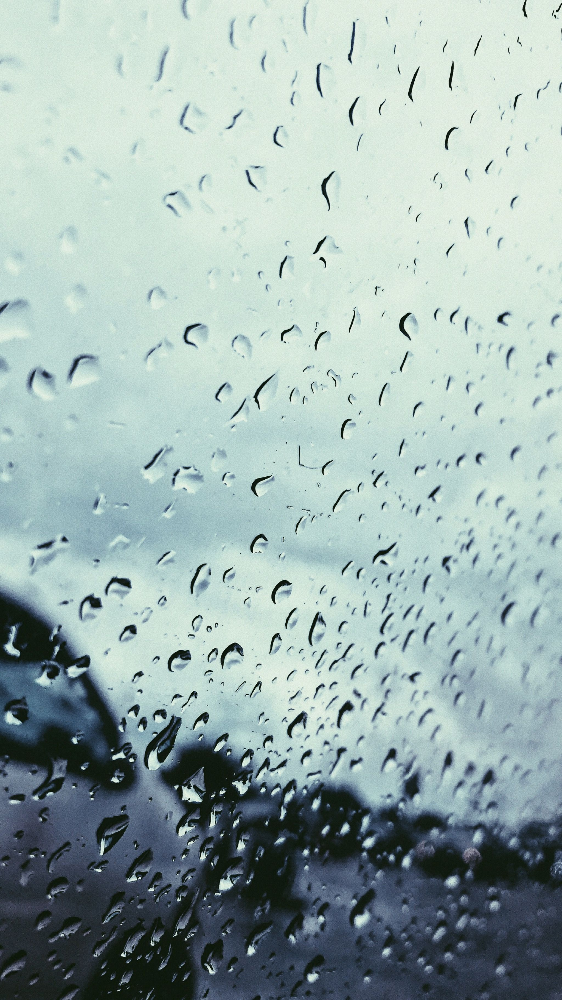
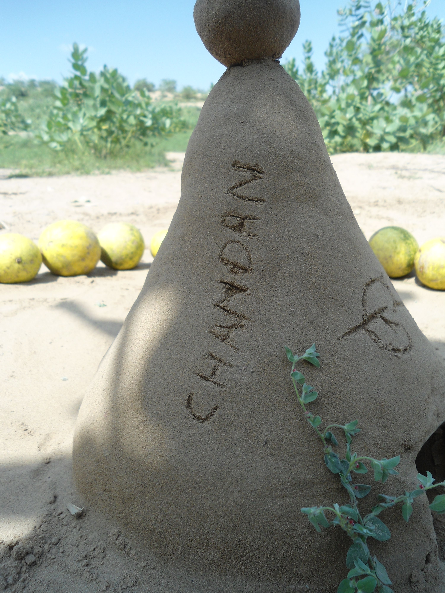

# Makanan Sehat: 5 Tren yang Bikin Hidup Lebih Seimbang

> *Catatan Editor CMS:* Artikel ini disusun dalam bahasa Indonesia formal, dengan gaya penulisan yang informatif dan relevan untuk audiens umum. Warna brand: merah (#B30006) + gold (#C9A227). Kontak: WhatsApp **0851-6593-5577**, Instagram **@kojo_onigiri**.

---

## Makanan Sehat: 5 Tren yang Bikin Hidup Lebih Seimbang

### 1. Makanan sehat bukan lagi sekadar tren, tapi kebutuhan aktifitas modern

Makanan sehat bukan lagi sekadar tren, tapi kebutuhan aktifitas modern. Banyak orang beralih ke pola makan yang lebih sadar dengan memilih bahan makanan utuh (whole foods) yang kaya nutrisi.

### 2. Berikut 5 tren makanan sehat yang sedang naik daun:
1

Berikut 5 tren makanan sehat yang sedang naik daun:
1. *Clean Eating* - fokus pada makanan utuh dan minim olahan
2. *Plant-Based* - kekuatan protein nabati dari tempe, tahu, kacang
3. *Functional Foods* - makanan yang punya manfaat kesehatan tambahan
4. *Local Food* - mendukung pelaku UMKM dan kuliner lokal
5. *Mindful Eating* - kesadaran akan porsi dan perlambatan proses makan

### 3. Kesimpulan: Hidup sehat dimulai dari pilihan makanan harian

Kesimpulan: Hidup sehat dimulai dari pilihan makanan harian.

---

## Penutup

Gaya hidup makanan yang sedang naik daun saat ini adalah cerminan dari kebutuhan akan keseimbangan antara hiburan, kesehatan, dan kesadaran lingkungan.

> **Untuk informasi lebih lanjut atau permintaan penulisan konten terkait blog, hubungi:**
> 📞 WhatsApp: **0851-6593-5577**
> 📸 Instagram: **@kojo_onigiri**

---

## Catatan Grafis & Brand Styling untuk CMS

- **Warna brand:** Merah (#B30006) + Gold (#C9A227)
- **Font:** Sans-serif standar (misal: Segoe UI, Arial, atau Inter)
- **Ukuran poster dunia:** 4:5 (1080×1350 px) untuk konten kelas properti
- **Tip tampilan:** Gunakan kontras yang baik, gambar foto makanan yang bersih dan terang, jangan gunakan flash berlebihan.
- **Lokasi penyimpanan:** `blog/articles/`

---

## Attribution

Gambar-gambar pada artikel ini dikumpulkan dari sumber bebas seperti Unsplash, Pexels, dan Pixabay dalam lisensi Unsplash License.

> Lisensi Unsplash: https://unsplash.com/license