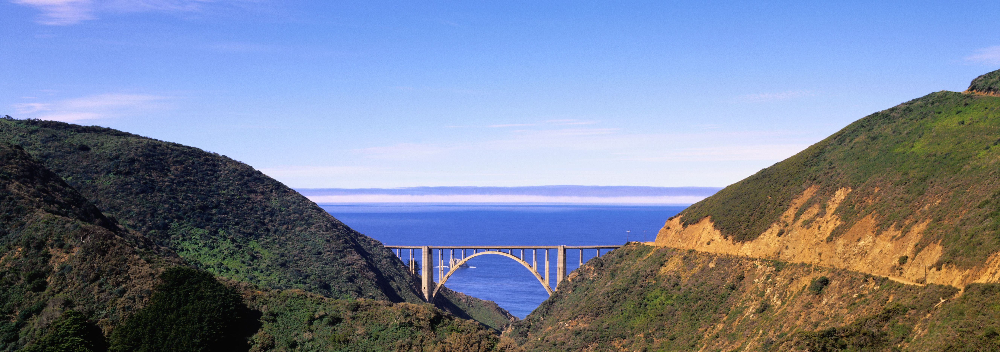

# Plant-Based: Gaya Hidup Makan Kaya Protein Nabati

> *Catatan Editor CMS:* Artikel ini disusun dalam bahasa Indonesia formal, dengan gaya penulisan yang informatif dan relevan untuk audiens umum. Warna brand: merah (#B30006) + gold (#C9A227). Kontak: WhatsApp **0851-6593-5577**, Instagram **@kojo_onigiri**.

---

## Plant-Based: Gaya Hidup Makan Kaya Protein Nabati

### 1. Plant-based kini semakin masuk ke lini konsumen umum

Plant-based kini semakin masuk ke lini konsumen umum. Bukan sekadar vegan, tapi lebih ke pilihan pola makan yang kaya protein nabati.

### 2. Tips memulai:
- Mulai dari 1-2 porsi nabati per hari
- Kombinasikan tempe, tahu, kacang-kacangan
- Jaga keseimbangan protein dan serat

Tips memulai:
- Mulai dari 1-2 porsi nabati per hari
- Kombinasikan tempe, tahu, kacang-kacangan
- Jaga keseimbangan protein dan serat

### 3. Kesimpulan: Plant-based adalah pilihan sehat yang ramah lingkungan

Kesimpulan: Plant-based adalah pilihan sehat yang ramah lingkungan.

---

## Penutup

Gaya hidup makanan yang sedang naik daun saat ini adalah cerminan dari kebutuhan akan keseimbangan antara hiburan, kesehatan, dan kesadaran lingkungan.

> **Untuk informasi lebih lanjut atau permintaan penulisan konten terkait blog, hubungi:**
> 📞 WhatsApp: **0851-6593-5577**
> 📸 Instagram: **@kojo_onigiri**

---

## Catatan Grafis & Brand Styling untuk CMS

- **Warna brand:** Merah (#B30006) + Gold (#C9A227)
- **Font:** Sans-serif standar (misal: Segoe UI, Arial, atau Inter)
- **Ukuran poster dunia:** 4:5 (1080×1350 px) untuk konten kelas properti
- **Tip tampilan:** Gunakan kontras yang baik, gambar foto makanan yang bersih dan terang, jangan gunakan flash berlebihan.
- **Lokasi penyimpanan:** `blog/articles/`

---

## Attribution

Gambar-gambar pada artikel ini dikumpulkan dari sumber bebas seperti Unsplash, Pexels, dan Pixabay dalam lisensi Unsplash License.

> Lisensi Unsplash: https://unsplash.com/license